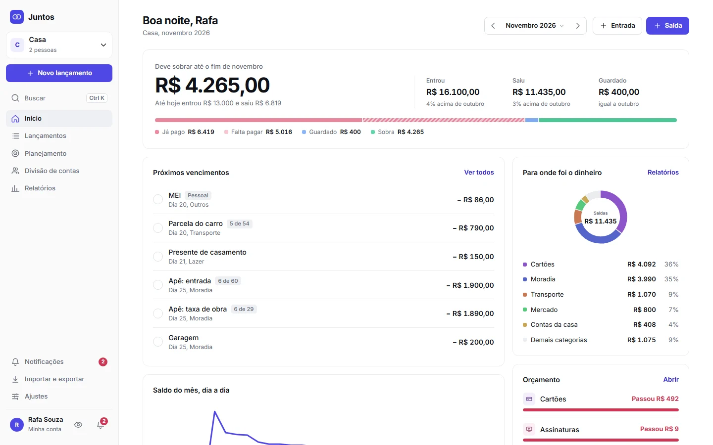
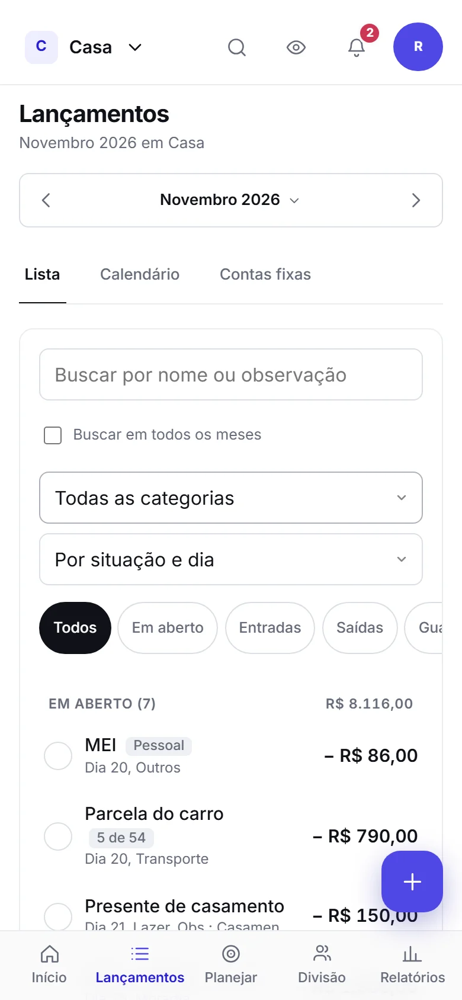
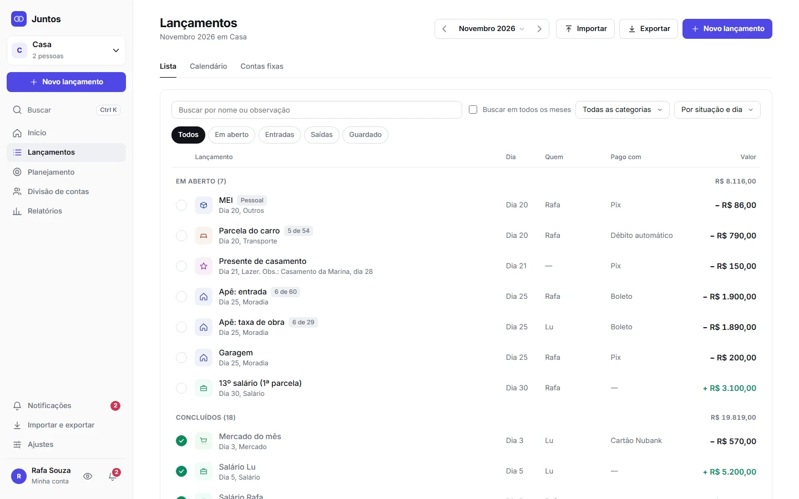
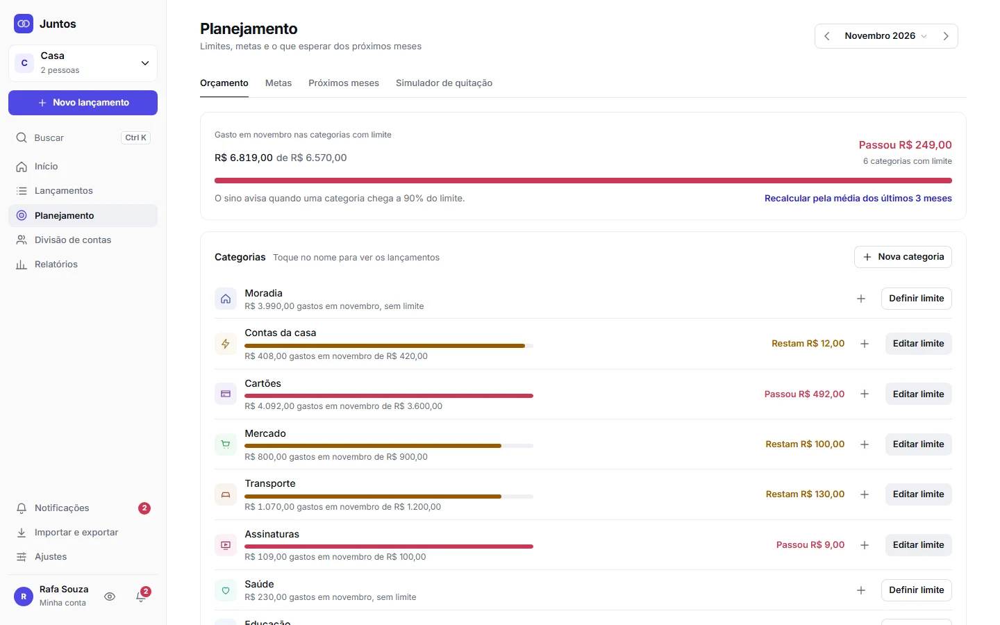
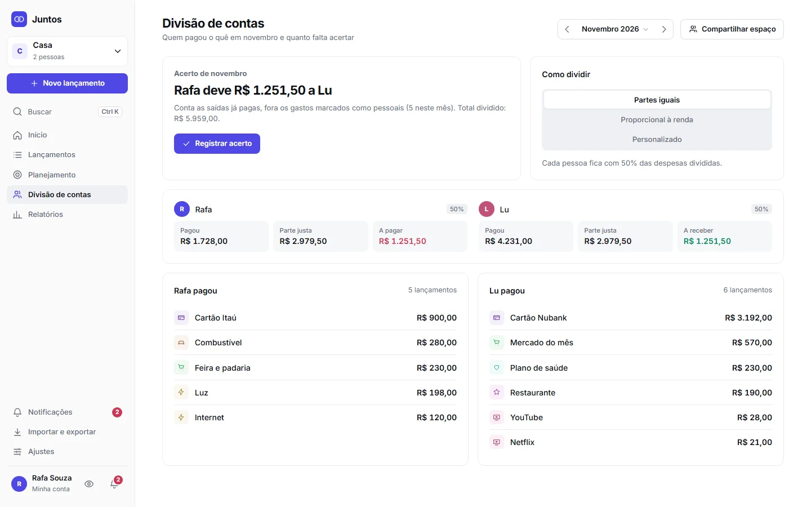
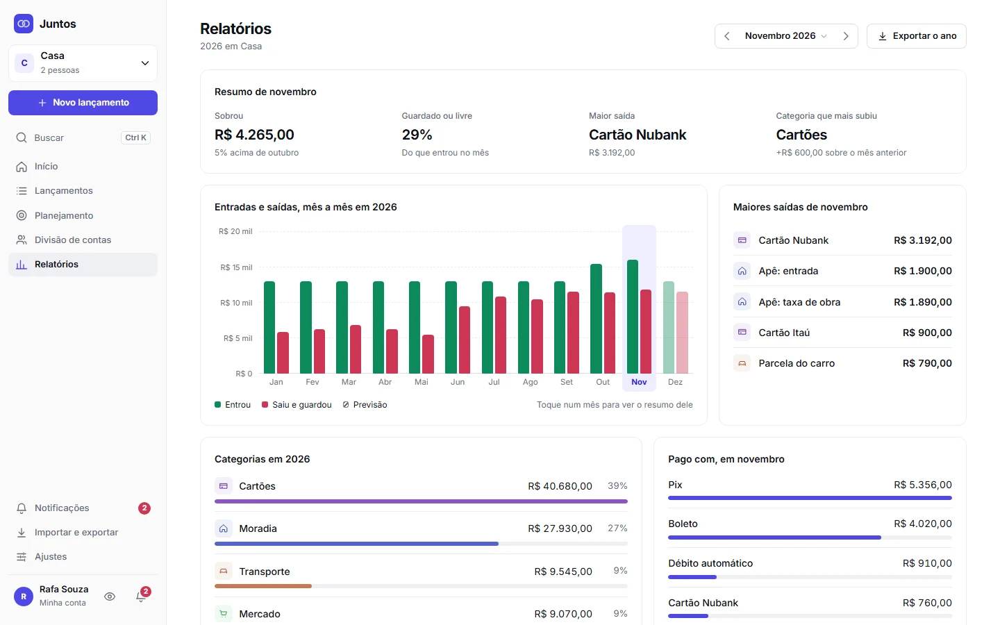
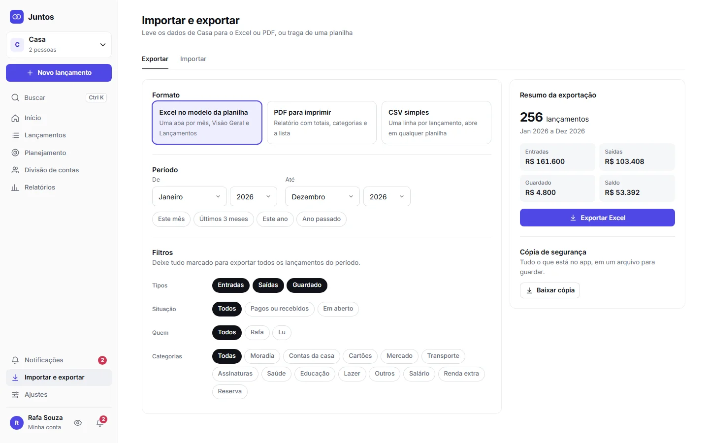
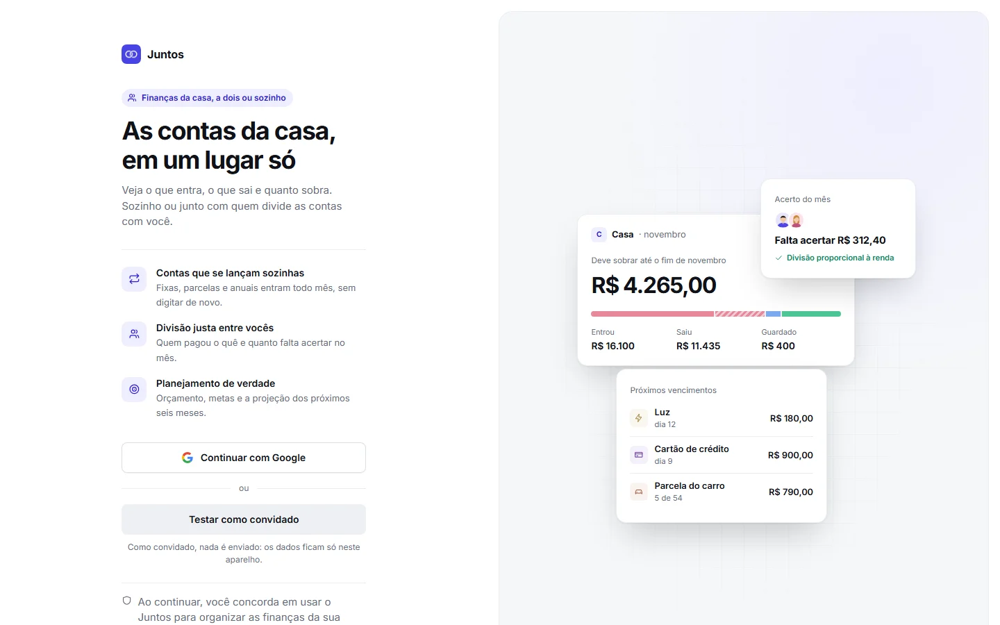
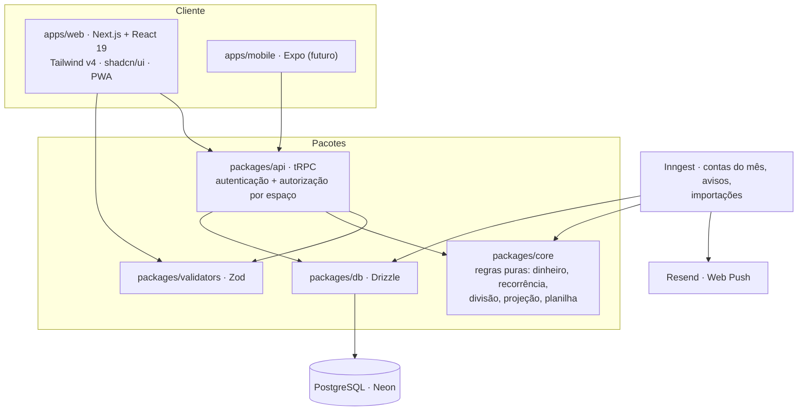

<div align="center">

# Juntos

**As contas da casa, em um lugar só. Sozinho ou a dois.**

[](https://github.com/NasckDev/juntos/actions/workflows/ci.yml)
[](LICENSE)


[**Abrir a demo**](https://nasck-myportifolio.vercel.app/projetos/juntos/) ·
[Plano de fases](docs/03-plano-de-fases.md) ·
[Modelo de dados](docs/02-modelo-de-dados.md) ·
[Decisões (ADRs)](docs/adr/)



</div>

## O problema

Um casal organizava o ano numa planilha do Excel: uma aba por mês, com **Renda mensal**, **Despesas mensais** (e uma
coluna dizendo se já foi pago) e **Economia mensal**, mais uma aba de Visão Geral. Funcionava, mas:

- toda conta fixa e toda parcela precisavam ser digitadas de novo a cada mês;
- ninguém sabia, no meio do mês, quanto ia sobrar até o fim;
- dividir as contas de forma justa entre os dois era feito de cabeça;
- no celular, onde 90 % do uso acontece, a planilha é quase inutilizável.

O **Juntos** faz tudo o que a planilha fazia e resolve esses quatro pontos, sem obrigar ninguém a abandonar o Excel:
ele importa a planilha antiga e exporta de volta no mesmo modelo, com as fórmulas nas mesmas células.

## O que já dá para usar (demo)

| | |
| --- | --- |
| **Contas que se lançam sozinhas** | Fixas, anuais e parceladas ("5 de 54") entram todo mês. Editar vale "só neste mês" ou "neste e nos próximos". |
| **Quanto vai sobrar** | Sobra prevista até o fim do mês, o que já foi pago e o que falta, saldo dia a dia e comparação com o mês anterior. |
| **Divisão justa** | Partes iguais, proporcional à renda ou personalizada. Mostra quem deve quanto a quem e registra o acerto. |
| **Planejamento** | Orçamento por categoria (com sugestão pela média de 3 meses), metas com previsão de data, projeção de 6 meses e simulador de quitação (Tabela Price). |
| **Planilha de volta** | Importa a planilha mensal com revisão linha a linha; exporta Excel no mesmo modelo, PDF e CSV, com filtros. |
| **Feito para o celular** | Barra inferior, botão flutuante, folhas de baixo, alvos de 44 px, busca Ctrl/⌘+K, atalhos, desfazer, tema claro e escuro, 11 cores e 4 tamanhos de letra. |

<p>



</p>

<details>
<summary>Mais telas no computador</summary>








</details>

> **Privacidade da demo:** os dados são fictícios e tudo o que você digita fica só no seu navegador (`localStorage`).
> Não há servidor, conta real nem coleta de dados. "Continuar com Google" é simulado nesta fase.

## Onde o projeto está

O projeto segue um plano em fases ([detalhes e critérios de aceite](docs/03-plano-de-fases.md)):

```mermaid
flowchart LR
  F0["0. Protótipo publicado ✅"] --> F1["1. Base: monorepo e design system"]
  F1 --> F2["2. Núcleo: regras com testes"]
  F2 --> F3["3. Dados e acesso"]
  F3 --> F4["4. Lançamentos"]
  F4 --> F5["5. Visão e relatórios"]
  F5 --> F6["6. Planejamento e divisão"]
  F6 --> F7["7. Importar e exportar"]
  F7 --> F8["8. Notificações"]
  F8 --> F9["9. Acabamento e produção"]
```



A **Fase 0** publica o protótipo navegável (a fonte da verdade de UX, textos e regras) e a documentação da etapa de
descoberta: [inventário de telas e regras](docs/01-inventario.md), [modelo de dados](docs/02-modelo-de-dados.md),
[plano](docs/03-plano-de-fases.md) e [dúvidas em aberto](docs/04-duvidas-e-decisoes.md).

### Arquitetura planejada



Decisões registradas: [protótipo como fonte da verdade](docs/adr/0001-prototipo-como-fonte-da-verdade.md),
[dinheiro em centavos inteiros](docs/adr/0002-dinheiro-em-centavos.md),
[repositório público sem dados reais](docs/adr/0003-repositorio-publico-sem-dados-reais.md) e
[stack proposta](docs/adr/0004-stack-proposta.md).

## Segurança e privacidade

- Nenhum dado real no repositório: só nomes e e-mails fictícios (`example.com`).
- `scripts/verificar-privacidade.mjs` barra planilhas, CSV, PDF, `.env`, tokens e e-mails reais. Ele roda no CI e no
  build da Vercel, e o deploy falha se achar algo.
- Cabeçalhos de produção: Content-Security-Policy restrita, `frame-ancestors` só para o portfólio, `nosniff`,
  `no-referrer` e `Permissions-Policy` fechada. Os testes rodam com esses mesmos cabeçalhos.
- Secret scanning, push protection e Dependabot ligados no GitHub. Vulnerabilidades: veja [SECURITY.md](SECURITY.md).

## Rodar localmente

Requer Node 20 ou mais novo.

```bash
npm install
npm run dev          # http://localhost:4791, com os mesmos cabeçalhos da Vercel
npm run verify       # varredura de privacidade + testes de ponta a ponta
npm run prints       # regenera os prints de docs/prints
```

Na primeira vez, baixe o navegador dos testes com `npx playwright install chromium`.

### Testes

Os 6 testes de ponta a ponta (Playwright) rodam no celular (390 px) e no computador (1440 px):

- a entrada abre sem erros com a CSP de produção;
- o Início mostra o resumo com os dados de exemplo;
- uma saída lançada aparece na lista do mês;
- a validação aparece embaixo do campo (`aria-invalid`);
- o Excel é exportado com a CSP ativa;
- nenhuma tela principal rola para o lado.

## Estrutura

```text
prototipo/index.html     demo publicada (fonte da verdade de UX e regras)
docs/                    inventário, modelo de dados, plano, dúvidas, ADRs, briefing e prints
scripts/                 servidor local, varredura de privacidade e geração de prints
tests/                   testes de ponta a ponta
vercel.json              publicação e cabeçalhos de segurança
```

## Licença

[MIT](LICENSE). Feito por [Alexandre Diogo](https://nasck-myportifolio.vercel.app).
