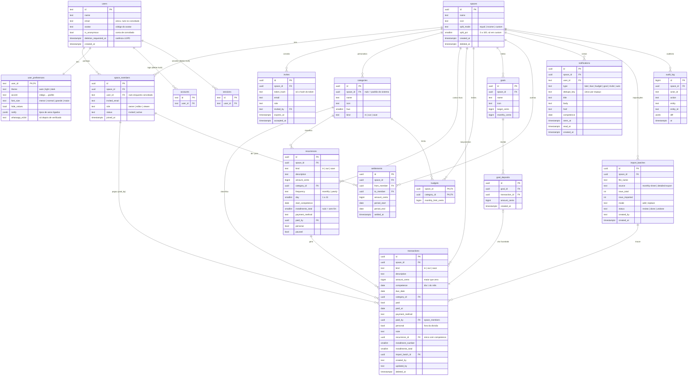

# 2. Modelo de dados (proposta)

Proposta para PostgreSQL com Drizzle. **Aguarda aprovação** antes da primeira migração (ver [plano de fases](03-plano-de-fases.md)).

Princípios:
- **Dinheiro em centavos inteiros** (`bigint`), nunca ponto flutuante ([ADR 0002](adr/0002-dinheiro-em-centavos.md)).
- **Tudo pertence a um espaço** (`space_id`), e toda consulta filtra por ele e confere o papel do membro no servidor.
- **Mês de competência** guardado como `date` no dia 1 (`competence`), separado da data de vencimento (`due_date`). Isso deixa o filtro por mês e período simples e indexável.
- **Soft delete e lotes** (`deleted_at`, `import_batch_id`, `undo_token`) para o "Desfazer" funcionar no servidor.
- **Idempotência** dos jobs: unicidade `(recurrence_id, competence)` em `transactions` e `(space_id, dedupe_key)` em `notifications`.

## Índices e restrições principais

| Tabela | Índice ou restrição | Para quê |
| --- | --- | --- |
| `transactions` | `(space_id, competence)` onde `deleted_at is null` | Mês e período (até 36 meses na exportação) |
| `transactions` | único `(recurrence_id, competence)` | Job de contas fixas idempotente |
| `transactions` | `check (amount_cents > 0)` | Valor sempre positivo; o tipo dá o sinal |
| `notifications` | único `(space_id, dedupe_key)` | Aviso não repete |
| `space_members` | único `(space_id, user_id)` e `(space_id, invited_email)` | Sem membro duplicado |
| `budgets` | chave `(space_id, category_id)` | Um limite por categoria |
| `invites` | `token_hash` único, `expires_at` | Convite de uso único que expira |

## Diferenças em relação ao briefing

- `competence` separada de `due_date`: o protótipo trabalha com "mês + dia" e o mês é o eixo de tudo.
- `goal_deposits.transaction_id`: no protótipo o depósito cria um lançamento Guardado; a ligação permite desfazer os dois juntos.
- `settlements.period_start/period_end`: o protótipo grava o acerto só no primeiro mês do período; com início e fim o acerto vale para o período inteiro.
- `invites.token_hash`: o token nunca é guardado em texto puro.
